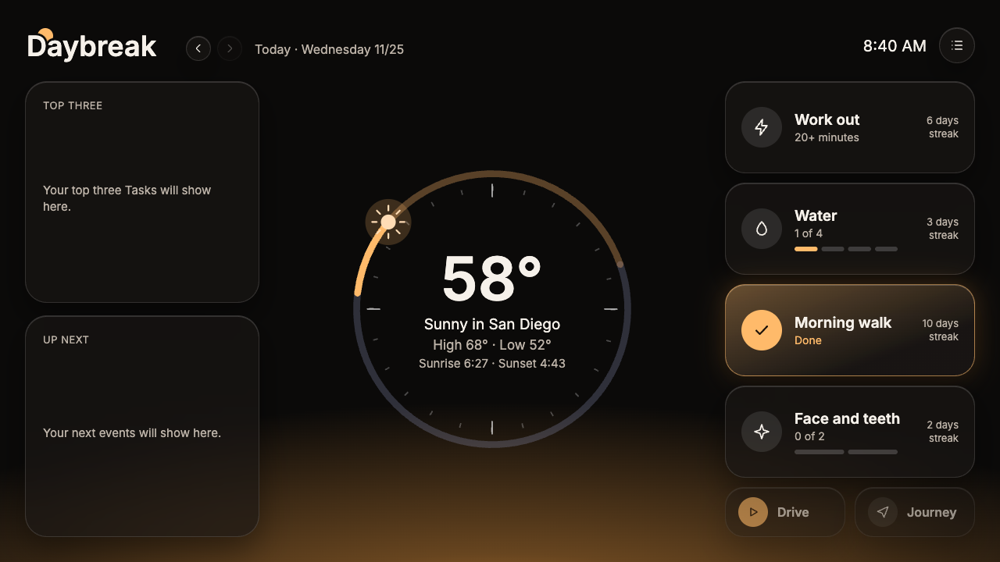
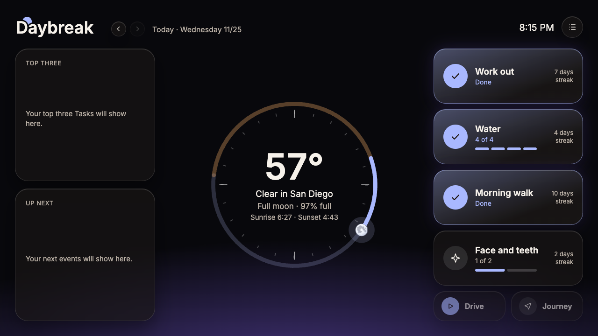
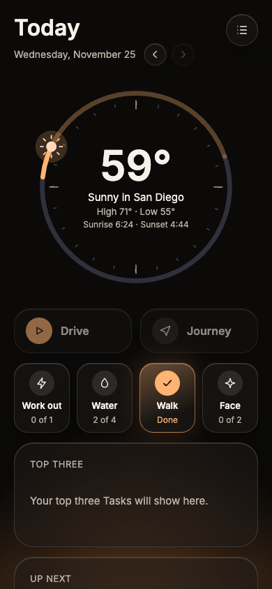

<h1 align="center">Daybreak</h1>

<p align="center">
  A personal app for health and focus.<br />
  One dark screen that shows the day and follows the sun.
</p>

<p align="center">
  
</p>

## What it is

Daybreak is the app I open every morning. It starts as a web app on my laptop
and phone, and it ends up living on a small touchscreen device I'm building
myself.

It's a for-fun project with two goals: make something I use every day, and
try out different AI-assisted workflows along the way.

## Today

Today is the home screen. The Sun Dial in the centre is a 24-hour ring with
noon at the top and midnight at the bottom. The sun rides the ring through
the day, and the weather sits inside it.

Habits are on the right. One tap completes a Habit or adds one to its count.
A long-press takes one back. Each Habit keeps a streak, and the day rolls
over at 4:00 am, so a late night still counts toward the day it started in.

A tap on one screen shows up on the other within a couple of seconds. Taps
made without a connection are kept and sent when it comes back.

Opening the app plays a short sunrise: the sun comes up over a horizon on
still water, the name appears in front of it, and the two settle into the
logo in the header.

## Colors that follow the sun

Nothing on the screen is a fixed accent color. The accent, the glow at the
bottom of the screen and the background blend between six stops that are
tied to the sun's position that day, so summer and winter look different.

| Dawn      | Morning   | Midday    | Sunset    | Evening   | Late night |
| --------- | --------- | --------- | --------- | --------- | ---------- |
| `#ffb3a1` | `#ffb46b` | `#ffd166` | `#ff9480` | `#a9b8ff` | `#8fb4ff`  |

After sunset the sun becomes a moon drawn at its real phase, and finished
Habits turn blue.

<p align="center">
  
</p>

## On the phone

The same screen becomes one scrolling column. The dial, Morning Drive,
Journey and the Habit squares all fit on the first screen.

<p align="center">
  
</p>

## What comes next

- **Tasks and events**: Apple Reminders and calendars on Today, with a
  suggested top three for the day.
- **Journeys**: focus sessions framed as a trip, with calming sound and
  visuals.
- **Morning Drive**: a wake-up mix of real news shows and music.
- **The Device**: the small plugged-in screen Daybreak is headed for.

Their places are already on Today. `docs/` has the spec, the design, the
decision records and the ticket list.

## How it's built

One React Native codebase (Expo) that runs as a web app in a browser and on
the Device, and later as an iPhone app. Supabase is the backend: database,
sign-in and live sync.

- `apps/daybreak` is the app.
- `packages/core` is shared logic with tests: day rollover, streaks, moon
  phase and the colors that follow the sun.
- `supabase` holds the database migrations and the weather function.

Weather comes from [Open-Meteo](https://open-meteo.com) and place names from
[OpenStreetMap](https://www.openstreetmap.org/copyright).

## Running it

Run these from the repo root.

| Command          | What it does                                 |
| ---------------- | -------------------------------------------- |
| `pnpm install`   | Install everything                           |
| `pnpm dev`       | Start the app in a browser                   |
| `pnpm test`      | Run the shared package's tests               |
| `pnpm typecheck` | Type-check every package                     |
| `pnpm build:web` | Build the web app into `apps/daybreak/dist`  |
| `pnpm format`    | Format with Prettier                         |
| `pnpm verify`    | Format check, typecheck, tests and web build |

The app needs a Supabase project. Put its address and public key in
`apps/daybreak/.env.local`:

```
EXPO_PUBLIC_SUPABASE_URL=https://<project-ref>.supabase.co
EXPO_PUBLIC_SUPABASE_PUBLISHABLE_KEY=<publishable key>
```

Build the database and the weather function from the repo:

```
pnpm dlx supabase link --project-ref <project-ref>
pnpm dlx supabase db push --remote
pnpm dlx supabase functions deploy weather --remote
```

Every push to `main` runs the checks and deploys the web app to Vercel.

To see the colors change without waiting a day, add a test clock to the
address: `?at=2026-11-25T05:30&speed=3600` starts at 5:30 am and runs an
hour every second.
